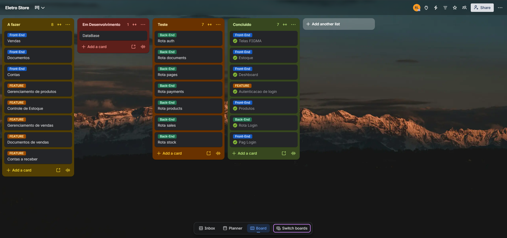
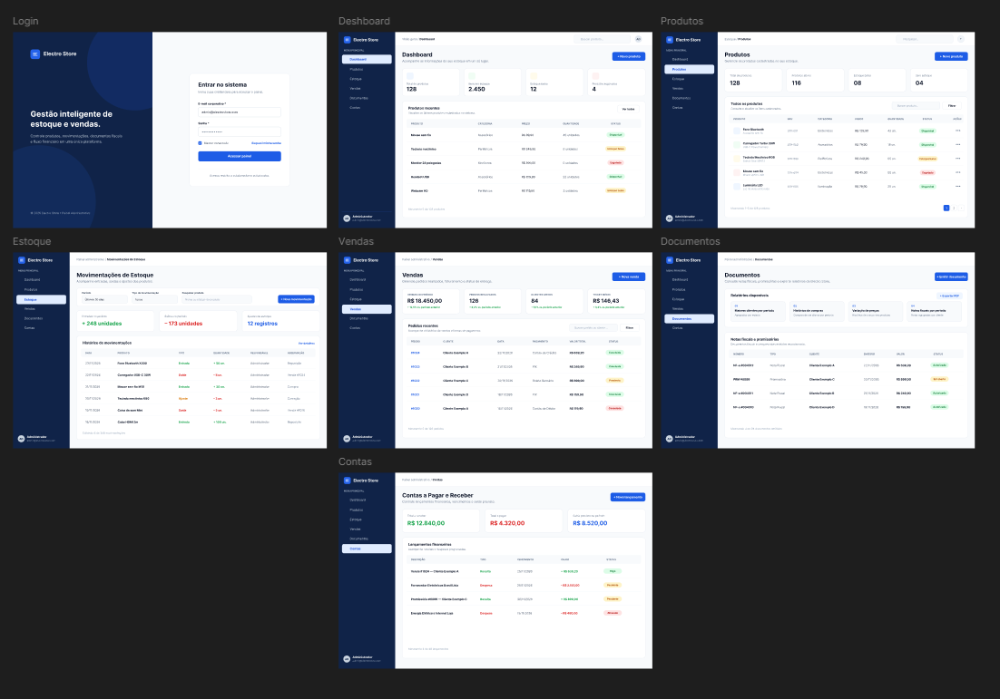

# Eletro Store — Sistema de estoque e vendas

Projeto acadêmico em HTML, CSS, JavaScript, Node.js, Express e SQLite.

## Aviso
Este é um projeto de trabalho academico não é feito para uso real

## Requisitos
- Node.js 20 ou superior
- npm

## Instalação e execução
```bash
npm start
```
Abra http://localhost:3000

## Acesso inicial
email: *admin@eletrostore.com*
senha: *admin123*


## Funcionalidades
Feature 01 — Autenticação e administração
Feature 02 — Gerenciamento de produtos
Feature 03 — Controle de estoque
Feature 04 — Gerenciamento de vendas
Feature 05 — Documentos de vendas
Feature 06 — Contas a receber

## Testes Selenium
```bash
pip install -r requirements.txt

```
```bash
node ./src/make-db.js

```
```bash
npm start

```

## Teste rápido com Selenium
```bash
python eletro-selenium/test_eletro_store.py

```

## Screenshots

